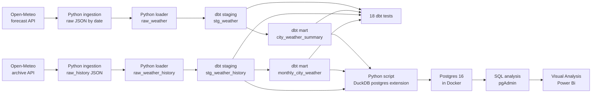
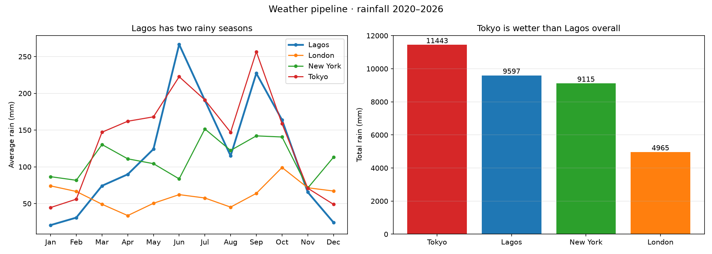
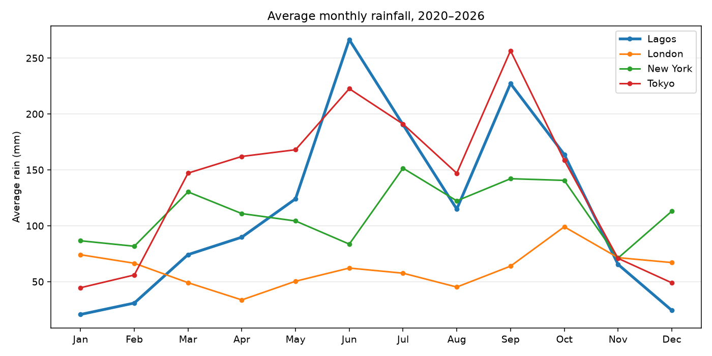
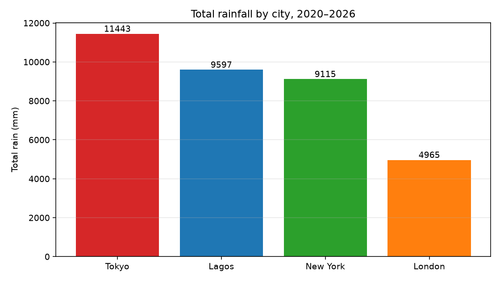

# Weather Pipeline

This is an end-to-end data pipeline that pulls weather data for four cities, lands the raw files untouched, loads them into DuckDB, cleans and tests everything with dbt, then copies the finished tables into Postgres (running in Docker) for SQL analysis.

It includes two flows:

- **Forecast:** the next 7 days of daily weather
- **History:** daily weather from 2020 to 17-10-2026 (about 6.8 years, nearly 10,000 rows)

Built as a hands-on project to practise the core data engineering workflow: ingest, load, transform, test, serve.

**Stack:** Python, DuckDB, dbt (dbt-duckdb), Postgres, Docker, Git

---

## How it works



| Stage | What happens | Where |
|---|---|---|
| 1. Ingest | Calls the Open-Meteo APIs for Lagos, London, New York and Tokyo and saves each response as raw JSON | `Ingestion/Fetch_Weather.py`, `Ingestion/Fetch_History.py` |
| 2. Load | Reads the raw JSON and loads it into DuckDB (`raw_weather` and `raw_weather_history`) | `Transform/load_to_duckdb.py`, `Transform/load_history.py` |
| 3. Stage | Casts dates to real date types, renames columns with units (`temp_max_c`, `precipitation_mm`) | `weather_dbt/models/staging/` |
| 4. Model | Builds a per-city forecast summary and a monthly history table (temperatures, rainfall, rainy days) | `weather_dbt/models/marts/` |
| 5. Test | Runs 18 data tests across the staging and mart models | `.yml` files, `weather_dbt/tests/` |
| 6. Serve | Copies three finished tables from DuckDB into a Postgres database running in Docker | `Transform/loading_to_data_base_postgres.py` |
| 7. Analyse | Runs SQL against Postgres, from Python, pgAdmin or VS Code | `postgres_query.py`, `Analysis/` |
| 8. Visualise | Exports marts to CSV for Power BI and saves the rainfall charts | `Transform/pipeline_visual.py`, `powerbi/` |

---

## Project structure

```
Weather-Pipeline/
├── Ingestion/
│   ├── Fetch_Weather.py                    # 7-day forecast -> raw JSON
│   └── Fetch_History.py                    # 2020 to last week -> raw JSON
├── Transform/
│   ├── load_to_duckdb.py                   # loads forecast JSON into DuckDB
│   ├── load_history.py                     # loads history JSON into DuckDB
│   ├── loading_to_data_base_postgres.py    # copies marts from DuckDB to Postgres
│   ├── pipeline_visual.py                # DuckDB marts -> CSV for Power BI
│   └── plot_analysis.py                    # rainfall charts from the marts
├── weather_dbt/
│   ├── dbt_project.yml
│   ├── profiles.yml
│   ├── models/
│   │   ├── staging/
│   │   │   ├── sources.yml
│   │   │   ├── schema.yml                  # forecast staging tests
│   │   │   ├── stg_weather.sql
│   │   │   ├── stg_weather_history.sql
│   │   │   └── stg_weather_history.yml
│   │   └── marts/
│   │       ├── schema.yml                  # forecast mart tests
│   │       ├── city_weather_summary.sql
│   │       ├── monthly_city_weather.sql
│   │       └── monthly_city_weather.yml
│   └── tests/
│       ├── assert_one_row_per_city_per_day.sql
│       ├── assert_temperatures_make_sense.sql
│       ├── assert_history_one_row_per_city_per_day.sql
│       └── assert_monthly_one_row_per_city_per_month.sql
├── Analysis/
│   ├── lagos_rainfall.sql                  # Lagos average rainfall by month
│   ├── city_monthly_rainfall.sql           # same query for all four cities
│   └── city_rainfall_totals.sql            # total rain and typical high by city
├── powerbi/
│   ├── build_report.md                     # how to build the Power BI visuals
│   ├── data/                               # CSV extracts for Power BI
│   └── charts/                             # rainfall dashboard images
├── Validation_Check.py                     # quick script to inspect the DuckDB tables
├── postgres_query.py                       # runs analysis queries against Postgres
└── .gitignore
```

Generated files (`weather.duckdb`, `raw_data/`, `.venv/`, and dbt's `target/` and `logs/`) are not committed. 
Running the pipeline recreates them.

The `raw_history/` JSON files are the exception, running `Fetch_History.py` refreshes them.

---

## Data source

Weather data comes from [Open-Meteo](https://open-meteo.com/).

It is free for non-commercial use and needs no API key.

Both flows request daily maximum temperature, minimum temperature and total precipitation.

- **Forecast flow:** the forecast endpoint, which returns the next 7 days.
- **History flow:** the archive endpoint, which serves modeled historical data back to 1940. The history script fetches 2020-01-01 up to a week before the run date, because the archive lags a few days behind.

The archive values are modeled (reanalysis) data, not readings from weather stations, so totals can differ from official station records.

---

## Getting started

### Requirements

- Python 3.12 (other recent versions should work)
- Git
- Docker Desktop (it is only needed for the Postgres step)

### Setup

```bash
git clone https://github.com/Badmosa/Weather-Pipeline.git

cd Weather-Pipeline

python -m venv .venv

source .venv/Scripts/activate      # Git Bash on Windows
# source .venv/bin/activate        # macOS / Linux

python -m pip install requests duckdb dbt-duckdb psycopg2-binary matplotlib
```

### Run the pipeline

To run the pipeline, run these commands from the project root.

```bash
# Forecast flow
python Ingestion/Fetch_Weather.py
python Transform/load_to_duckdb.py

# History flow
python Ingestion/Fetch_History.py
python Transform/load_history.py

# Build and test the dbt models
cd weather_dbt
dbt run --profiles-dir .
dbt test --profiles-dir .
cd ..
```

### Load the marts into Postgres

Running a Postgres container with a password:

```bash
docker run --name weather-postgres \
  -e POSTGRES_PASSWORD=<set password> \
  -e POSTGRES_DB=weather \
  -p 5432:5432 -d postgres:16
```

For the password not to end-up in the repo, the scripts reads the already setted password as an environment variable before runing the loader:   

```bash
export POSTGRES_PASSWORD=<password>
python Transform/loading_to_data_base_postgres.py
```

This copies `city_weather_summary`, `monthly_city_weather` and `stg_weather_history` into the `weather` database.

### Query the results

- **From Python:** `python postgres_query.py`
- **From a SQL client:** connect pgAdmin PostgreSQL extension to `localhost`, port `5432`, database `weather`, user `postgres`, and run the files in `Analysis/`.
- **DuckDB only:** `python Validation_Check.py` inspects the DuckDB tables directly.
- **Power BI:** `python Transform/pipeline_visual.py`, then follow `powerbi/build_report.md`.

---

## Power BI

The serving layer for a dashboard is `monthly_city_weather`. The export script writes three CSV files that Power BI can open without Postgres:

```bash
python Transform/pipeline_visual.py
python Transform/plot_analysis.py
```

| File | Grain | Use in Power BI |
|---|---|---|
| `powerbi/data/city_month_climatology.csv` | city × calendar month | line chart of typical rainfall |
| `powerbi/data/monthly_city_weather.csv` | city × year-month | totals, slicers, year comparisons |
| `powerbi/data/city_weather_summary.csv` | one row per city | 7-day forecast page |

Build steps and field lists are in `powerbi/build_report.md`. The two findings below are also saved as `powerbi/charts/rainfall_dashboard.png` so they show on GitHub without opening Power BI.

---

## Analysis

All figures come from the history flow, January 2020 to October 2026 (about 6 years and 8 months of data). SQL lives in `Analysis/`.



### Lagos has two rainy seasons

Averaging each calendar month across the years:

- **Main rains:** June is the wettest month, averaging 266.5 mm with about 27 rainy days.
- **The August break:** rainfall drops to roughly 115 mm in August, between the two peaks.
- **Second rains:** September (about 227 mm) and October (about 164 mm).
- **Dry season:** December to February, with January as the driest month at about 20.7 mm.



### Tokyo is the wettest city, not Lagos

| City | Avg daily high | Total rain | Roughly per year |
|---|---|---|---|
| Tokyo | 20.9 C | 11,443 mm | 1,680 mm |
| Lagos | 30.2 C | 9,597 mm | 1,410 mm |
| New York | 17.6 C | 9,115 mm | 1,340 mm |
| London | 15.9 C | 4,965 mm | 730 mm |

I expected Lagos to be the wettest. Its rain is packed into a few heavy months, while Tokyo's rainfall is spread across the year, so Tokyo comes out ahead.



---

## Sample output

### Lagos rainfall by month, 2025 (`monthly_city_weather`)

| Month | Rain (mm) | Rainy days |
|---|---|---|
| Jan | 23.8 | 11 |
| Feb | 51.3 | 15 |
| Mar | 96.4 | 21 |
| Apr | 173.7 | 22 |
| May | 195.4 | 23 |
| Jun | 339.3 | 29 |
| Jul | 101.9 | 19 |
| Aug | 106.0 | 19 |
| Sep | 224.9 | 25 |
| Oct | 192.0 | 26 |
| Nov | 69.0 | 21 |
| Dec | 71.8 | 23 |

A rainy day here means 1 mm or more.

### 7-day forecast summary (`city_weather_summary`, run on 17 Oct 2026)

| city | days_recorded | avg_max_temp_c | avg_min_temp_c | hottest_day_c | coldest_day_c | total_rain_mm |
|---|---|---|---|---|---|---|
| Lagos | 7 | 30.1 | 26.3 | 30.4 | 25.8 | 58.3 |
| London | 7 | 14.1 | 9.0 | 15.0 | 6.9 | 23.7 |
| New York | 7 | 17.0 | 7.2 | 18.9 | 2.1 | 0.4 |
| Tokyo | 7 | 24.6 | 16.1 | 30.2 | 11.8 | 11.8 |

The forecast numbers change on every run, since the API returns a fresh 7 days each time.

---

## Data tests

All 18 tests pass on the current data.

| Area | Tests | What they check |
|---|---|---|
| `stg_weather` | 5 | `city`, `weather_date`, `temp_max_c`, `temp_min_c` are never empty, and `city` is one of the four expected cities |
| `city_weather_summary` | 2 | `city` is never empty and appears exactly once |
| `stg_weather_history` | 5 | same column checks as the forecast staging model |
| `monthly_city_weather` | 2 | `city` and `month_start` are never empty |
| `assert_one_row_per_city_per_day` | 1 | no duplicate city and date rows in the forecast data |
| `assert_history_one_row_per_city_per_day` | 1 | no duplicate city and date rows in the history data |
| `assert_temperatures_make_sense` | 1 | a day's low is never above its high, and no temperature falls outside -60 to 60 degrees C (forecast and history) |
| `assert_monthly_one_row_per_city_per_month` | 1 | no duplicate city and month rows in the monthly mart |

A dbt test passes when its query returns zero rows. The custom tests work by selecting the "bad" rows.

---

## Roadmap

- [x] Forecast and history ingestion
- [x] dbt staging and mart models with 18 tests
- [x] Postgres in Docker, with the marts loaded into it
- [x] SQL analysis (Lagos rainfall, city comparison)
- [x] Make the forecast load idempotent
- [x] Power BI dataset and rainfall visuals on `monthly_city_weather`

---

## Author

**Badmos Adesola Ayomide**
**Data Engineer**.

- LinkedIn: [linkedin.com/in/badmosayomide](https://linkedin.com/in/badmosayomide)

- Other Projects: [datascienceportfol.io/badmosayomide02](https://datascienceportfol.io/badmosayomide02)

Weather data by [Open-Meteo.com](https://open-meteo.com/).

Happy to welcome all feedback and suggestions.
