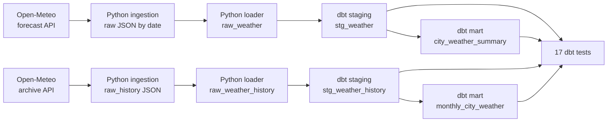

# Weather Pipeline

This is an end-to-end data pipeline that pulls weather data for four cities, lands the raw files untouched, loads them into a local database, then cleans, models and tests everything with dbt.

It runs two flows side by side:

- **Forecast:** the next 7 days of daily weather
- **History:** daily observations from 2020 to last week (about 6.8 years, nearly 10,000 rows)

Built as a hands-on project to practise the core data engineering workflow: ingest, load, transform, test.

**Stack:** Python, DuckDB, dbt (dbt-duckdb), Git

---

## How it works



| Stage | What happens | Where |
|---|---|---|
| 1. Ingest | Calls the Open-Meteo APIs for Lagos, London, New York and Tokyo and saves each response as raw JSON | `Ingestion/Fetch_Weather.py`, `Ingestion/Fetch_History.py` |
| 2. Load | Reads the raw JSON and loads it into DuckDB (`raw_weather` and `raw_weather_history`) | `Transform/load_to_duckdb.py`, `Transform/load_history.py` |
| 3. Stage | Casts dates to real date types, renames columns with units (`temp_max_c`, `precipitation_mm`) | `weather_dbt/models/staging/` |
| 4. Model | Builds a per-city forecast summary and a monthly history table (temperatures, rainfall, rainy days) | `weather_dbt/models/marts/` |
| 5. Test | Runs 17 data tests across the staging and mart models | `schema.yml` / `.yml` files, `weather_dbt/tests/` |

---

## Project structure

```
Weather-Pipeline/
├── Ingestion/
│   ├── Fetch_Weather.py              # 7-day forecast -> raw JSON
│   └── Fetch_History.py              # 2020 to last week -> raw JSON
├── Transform/
│   ├── load_to_duckdb.py             # loads forecast JSON into DuckDB
│   └── load_history.py               # loads history JSON into DuckDB
├── weather_dbt/
│   ├── dbt_project.yml
│   ├── profiles.yml
│   ├── models/
│   │   ├── staging/
│   │   │   ├── sources.yml
│   │   │   ├── schema.yml            # forecast staging tests
│   │   │   ├── stg_weather.sql
│   │   │   ├── stg_weather_history.sql
│   │   │   └── stg_weather_history.yml
│   │   └── marts/
│   │       ├── schema.yml            # forecast mart tests
│   │       ├── city_weather_summary.sql
│   │       ├── monthly_city_weather.sql
│   │       └── monthly_city_weather.yml
│   └── tests/
│       ├── assert_one_row_per_city_per_day.sql
│       ├── assert_temperatures_make_sense.sql
│       └── assert_history_one_row_per_city_per_day.sql
├── Validation_Check.py               # quick script to inspect the tables
└── .gitignore
```

Generated files (`weather.duckdb`, `raw_data/`, `raw_history/`, `.venv/`, and dbt's `target/` and `logs/`) are not committed. Running the pipeline recreates them.

---

## Data source

Weather data comes from [Open-Meteo](https://open-meteo.com/), which is free for non-commercial use and needs no API key. Both flows request daily maximum temperature, minimum temperature and total precipitation.

- **Forecast flow:** the forecast endpoint, which returns the next 7 days.
- **History flow:** the archive endpoint, which serves modeled historical data back to 1940. The history script fetches 2020-01-01 up to a week before the run date, because the archive lags a few days behind.

The archive values are modeled (reanalysis) data, not readings from weather stations, so totals can differ from official station records.

Cities and coordinates live in a dictionary at the top of each ingestion script. To add a city, add it to both scripts and to the `accepted_values` tests in the staging `.yml` files.

---

## Getting started

### Requirements

- Python 3.12 (other recent versions should work)
- Git

### Setup

```bash
git clone https://github.com/Badmosa/Weather-Pipeline.git
cd Weather-Pipeline

python -m venv .venv
source .venv/Scripts/activate      # Git Bash on Windows
# source .venv/bin/activate        # macOS / Linux

python -m pip install requests duckdb dbt-duckdb
```

### Run the pipeline

Run these from the project root.

```bash
# Forecast flow
python Ingestion/Fetch_Weather.py
python Transform/load_to_duckdb.py

# History flow
python Ingestion/Fetch_History.py
python Transform/load_history.py

# Build and test the dbt models
cd weather_dbt
dbt run --profiles-dir .
dbt test --profiles-dir .
```

### Look at the results

From the project root:

```bash
python Validation_Check.py
```

Or open `weather.duckdb` with any DuckDB client and query the marts directly.

---

## Sample output

### Lagos rainfall by month, 2025 (`monthly_city_weather`)

| Month | Rain (mm) | Rainy days |
|---|---|---|
| Jan | 23.8 | 11 |
| Feb | 51.3 | 15 |
| Mar | 96.4 | 21 |
| Apr | 173.7 | 22 |
| May | 195.4 | 23 |
| Jun | 339.3 | 29 |
| Jul | 101.9 | 19 |
| Aug | 106.0 | 19 |
| Sep | 224.9 | 25 |
| Oct | 192.0 | 26 |
| Nov | 69.0 | 21 |
| Dec | 71.8 | 23 |

Lagos' two rainy seasons show up clearly: a main peak in June, a dip in July and August, then a second rise in September and October. A rainy day here means 1 mm or more.

### City comparison, January 2020 to October 2026 (about 6.8 years)

| City | Avg daily high | Total rain |
|---|---|---|
| Tokyo | 20.9 C | 11,442 mm |
| Lagos | 30.2 C | 9,556 mm |
| New York | 17.6 C | 9,105 mm |
| London | 15.9 C | 4,958 mm |

### 7-day forecast summary (`city_weather_summary`, run on 17 Oct 2026)

| city | days_recorded | avg_max_temp_c | avg_min_temp_c | hottest_day_c | coldest_day_c | total_rain_mm |
|---|---|---|---|---|---|---|
| Lagos | 7 | 30.1 | 26.3 | 30.4 | 25.8 | 58.3 |
| London | 7 | 14.1 | 9.0 | 15.0 | 6.9 | 23.7 |
| New York | 7 | 17.0 | 7.2 | 18.9 | 2.1 | 0.4 |
| Tokyo | 7 | 24.6 | 16.1 | 30.2 | 11.8 | 11.8 |

The forecast numbers change on every run, since the API returns a fresh 7 days each time.

---

## Data tests

All 17 tests pass on the current data.

| Area | Tests | What they check |
|---|---|---|
| `stg_weather` | 5 | `city`, `weather_date`, `temp_max_c`, `temp_min_c` are never empty, and `city` is one of the four expected cities |
| `city_weather_summary` | 2 | `city` is never empty and appears exactly once |
| `stg_weather_history` | 5 | same column checks as the forecast staging model |
| `monthly_city_weather` | 2 | `city` and `month_start` are never empty |
| `assert_one_row_per_city_per_day` | 1 | no duplicate city and date rows in the forecast data |
| `assert_history_one_row_per_city_per_day` | 1 | no duplicate city and date rows in the history data |
| `assert_temperatures_make_sense` | 1 | a day's low is never above its high, and no temperature falls outside -60 to 60 degrees C |

A dbt test passes when its query returns zero rows. The custom tests work by selecting the "bad" rows.

---

## Design decisions

- **Raw data is kept as-is.** API responses are saved to disk before any cleaning. If a transformation has a bug, I can reprocess from the original files without calling the API again.
- **Forecast and history are separate.** They live in different folders, tables and models. A forecast is a prediction and history is what was recorded, so mixing them would blur the meaning of the data.
- **The history load is a full refresh.** `load_history.py` drops and rebuilds its table each run, so re-running never creates duplicates.
- **Staging is a view, marts are tables.** Staging is a light cleaning layer, so a view is enough. Marts are what a dashboard would read, so they are materialised as tables.
- **Paths are anchored to the project root.** The newer scripts find their folders relative to the file itself, so they work no matter where they are run from.
- **DuckDB for local development.** It runs in-process from a single file, with no server or account.
- **Tests live next to the models.** Column checks sit in `.yml` files, and rules that need custom logic are standalone SQL files in `tests/`.

---

## Known limitations

- **The forecast loader is not idempotent.** `load_to_duckdb.py` inserts rows every time it runs, so running it twice on the same data creates duplicates. The `assert_one_row_per_city_per_day` test catches this. For now, delete the `raw_weather` table (or `weather.duckdb`) before a fresh load.
- **Modeled history.** The archive data is modeled, not station-measured.
- **Manual runs.** Each step is run by hand. Nothing is scheduled yet.

---

## Roadmap

- [ ] Make the forecast load idempotent
- [ ] Add incremental models in dbt
- [ ] Load the marts into Postgres and build a dashboard on `monthly_city_weather`
- [ ] Orchestrate the whole run on a daily schedule
- [ ] Run it in Docker
- [ ] Add more cities and more weather variables

---

## Author

**Badmos Adesola Ayomide**, **data engineer.**

- LinkedIn: [linkedin.com/in/badmosayomide](https://linkedin.com/in/badmosayomide)

- Other Projects: [datascienceportfol.io/badmosayomide02](https://datascienceportfol.io/badmosayomide02)


Feedback and suggestions are welcome.

Weather data by [Open-Meteo.com](https://open-meteo.com/).